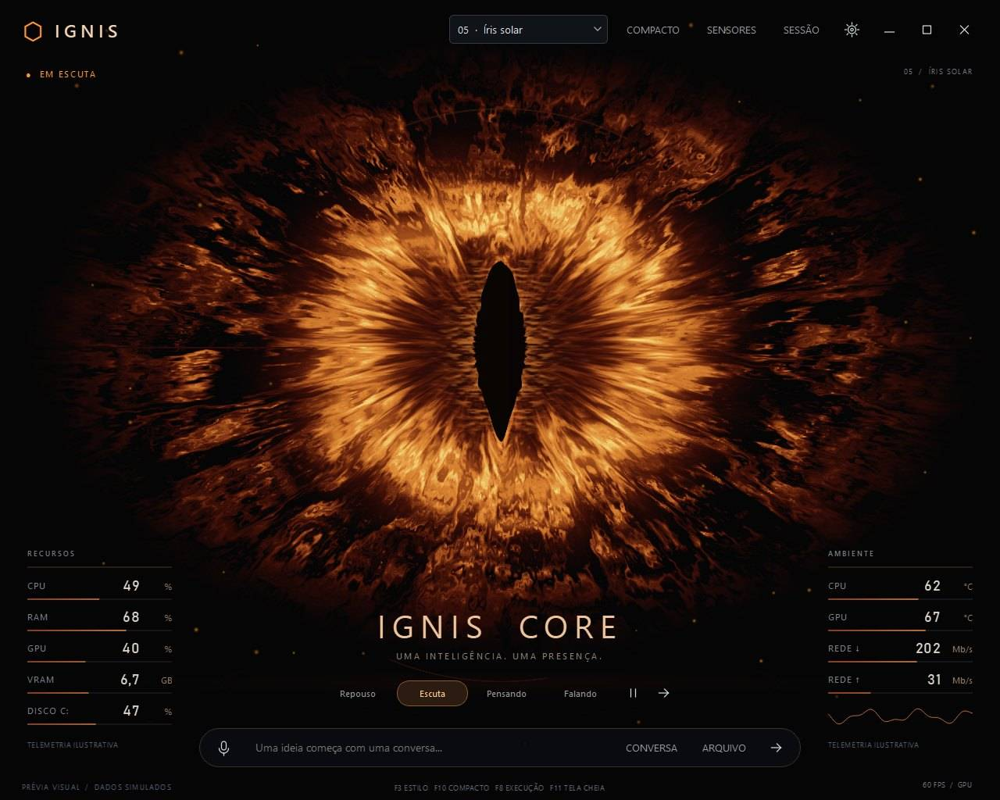

# JARVIS NEXUS

> **Alpha / Active Development** — assistente pessoal experimental para Windows com voz, agentes de IA, execução de tarefas e uma arquitetura em evolução para memória persistente e múltiplos núcleos visuais.


## Visão geral

O **JarvisNexus** é um projeto de assistente pessoal com IA focado em interação por voz, execução agente, automação no Windows e uma experiência visual própria.

A versão atual combina diferentes componentes para separar **escuta**, **conversa**, **execução profunda**, **voz**, **permissões** e **observabilidade**. O objetivo de longo prazo é transformar essa estrutura em um núcleo de agente próprio, modular e independente de um único framework ou provedor de IA.

O projeto começou a partir da exploração de uma base open source publicada no GitHub e, desde as primeiras versões, foi sendo ampliado em vários pontos da experiência e da arquitetura. A evolução atual está concentrada em uma camada própria chamada `nexus/`, que separa voz, agente, permissões, execução, diagnóstico, observabilidade e preferências do restante do sistema.

## Principais evoluções já implementadas

### Reconhecimento de voz com Groq

O JarvisNexus adiciona um fluxo próprio de STT utilizando **Groq + Whisper Large V3**. Nos testes práticos realizados durante o desenvolvimento, esse fluxo apresentou reconhecimento de fala mais preciso e confiável para o uso pretendido no Nexus do que o caminho de escuta utilizado anteriormente.

A implementação inclui:

- captura manual de áudio PCM16;
- envio para `whisper-large-v3` ou `whisper-large-v3-turbo`;
- credencial armazenada fora do código;
- reutilização de conexão HTTP;
- limite explícito de gravação;
- preservação da última captura WAV local para diagnóstico de cortes, sem incluir credenciais.

### Agente profundo com OpenCode + OpenAI

Foi adicionada uma camada própria para execução agente através do **OpenCode**, utilizada separadamente do fluxo de conversa rápida.

Entre as funções implementadas estão:

- inicialização de um servidor OpenCode local isolado para o Nexus;
- suporte às APIs v1 e v2 do OpenCode;
- seleção de modelos e variantes de raciocínio;
- uso de workspace definido pelo usuário;
- sessões próprias do agente;
- envio de texto e imagens ao modelo;
- monitoramento de status e recuperação de falhas.

### Permissões e segurança do agente

O Nexus adiciona regras próprias para controlar o que o agente pode fazer:

- leitura e edição dentro do workspace autorizado;
- solicitação de confirmação para arquivos sensíveis;
- confirmação para acesso fora do workspace;
- confirmação para comandos de shell não previamente seguros;
- comandos de inspeção como `git status`, `git diff` e `git log` podem ser liberados sem interromper o fluxo;
- validação das regras antes de aplicá-las ao agente.

### Visão de tela com consentimento

O agente pode receber uma captura da tela quando o usuário pede explicitamente para analisar o monitor.

O fluxo inclui:

- detecção de pedidos explícitos para visualizar a tela;
- seleção de monitor;
- prévia local antes do envio;
- confirmação manual da imagem;
- compressão e limite de tamanho;
- verificação do anexo recebido pelo agente através do conteúdo exato da captura.

### Painel de execução do agente

O JarvisNexus ganhou um painel separado para acompanhar tarefas profundas, com:

- etapas e ferramentas executadas;
- comandos, resultados e duração;
- mensagens públicas do agente;
- diffs e verificações de arquivos;
- cancelamento da tarefa;
- acompanhamento de progresso sem obrigar a interface a abrir o painel automaticamente.

### Logs, diagnóstico e verificações

A camada Nexus adiciona mecanismos próprios para acompanhar o que realmente aconteceu:

- registro efêmero das ações executadas na sessão;
- distinção entre ação confirmada, falha, aguardando confirmação e resultado não verificado;
- `Activity.log` opcional para conversas completas;
- deduplicação de mensagens;
- sanitização de informações sensíveis;
- diagnósticos específicos do agente e do STT;
- verificações locais de arquivos antes de afirmar que uma tarefa foi concluída.

### Voz do agente

As respostas textuais do agente podem ser encaminhadas para **Gemini Live** como camada independente de voz, sem dar à sessão de voz acesso às ferramentas do agente.

Esse fluxo inclui reprodução PCM, controle de buffer, cancelamento, verificação por transcrição e tratamento de limites da API.

### Sistema visual modular

Antes mesmo da integração completa do IGNIS, o Nexus já adicionou um sistema de núcleos renderizados em tempo real com diferentes estilos, incluindo:

- Reactor;
- Plasma;
- Orbit;
- Radar;
- Neural;
- Avatar.

Também existem preferências próprias de intensidade, partículas, grid, movimento reduzido e modo de desempenho.

### Infraestrutura de desenvolvimento

O projeto inclui ainda:

- scripts próprios de instalação, inicialização e diagnóstico no Windows;
- configuração dedicada do Groq;
- preferências próprias para agente e visual;
- testes de regressão das versões V14 a V19;
- validações específicas para permissões, histórico, edição de arquivos e comportamento da interface.

## Em desenvolvimento

- integração completa da interface **IGNIS Core**;
- múltiplos núcleos visuais selecionáveis;
- memória persistente / **Second Brain** com Obsidian;
- integração ampliada com **Skills e MCPs**;
- wake word local `Jarvis` no fluxo Nexus;
- roteamento mais avançado entre conversa rápida e agente profundo;
- núcleo próprio de orquestração para reduzir a dependência de OpenCode;
- provedores de modelos intercambiáveis.

## Arquitetura atual

```text
Microfone
   │
   ▼
Groq Whisper / Gemini Live
   │
   ▼
JARVIS NEXUS
   │
   ├── Conversa / voz
   │
   └── Agente profundo
          │
          ▼
     OpenCode + OpenAI
          │
          ▼
  Ferramentas / permissões
          │
          ├── arquivos e workspace
          ├── captura de tela
          ├── automação
          └── monitor de execução

Próxima camada:
Obsidian / memória persistente + Skills / MCP + IGNIS Core
```

## Novo visual — IGNIS Core

**IGNIS** é o primeiro núcleo visual desenvolvido como nova identidade do JarvisNexus. Diferente de um mockup estático, ele **já possui implementação visual própria**; a etapa atual é conectar o runtime real do JarvisNexus a essa interface.

A integração prevista liga ao IGNIS os estados reais de **repouso, escuta, processamento, execução e fala**, além de voz, agente e telemetria. Na captura abaixo, o visual já existe em código, enquanto os valores de telemetria ainda são ilustrativos até a conexão completa com o backend.

<p align="center">
  
</p>

<p align="center"><sub><b>IGNIS Core</b> — implementação visual atual que está sendo integrada ao sistema do JarvisNexus.</sub></p>

## Estrutura do projeto

```text
actions/      Ações e automações disponíveis ao assistente
core/         Componentes centrais de voz, áudio, Gemini e runtime
memory/       Camada de memória existente
nexus/        Camada própria do JarvisNexus para agente e orquestração
providers/    Provedores de STT, LLM e TTS
plugins/      Sistema de extensões
scripts*      Instalação, inicialização e diagnóstico no Windows
tests/        Testes de regressão do agente
assets/       Mídia pública do projeto
```

## Instalação da V19

### Requisitos principais

- Windows
- Python 3.12
- OpenCode instalado e autenticado para o modo de agente
- chave Groq própria para o fluxo de STT
- credenciais dos provedores que você optar por utilizar

### Preparação

No PowerShell, dentro da pasta do projeto:

```powershell
powershell -NoProfile -ExecutionPolicy Bypass -File .\INSTALAR.ps1
```

Configure o Groq pelo fluxo local do projeto:

```powershell
powershell -NoProfile -ExecutionPolicy Bypass -File .\CONFIGURAR-GROQ.ps1
```

Antes de iniciar, rode a verificação da versão:

```powershell
powershell -NoProfile -ExecutionPolicy Bypass -File .\VERIFICAR-V19.ps1
```

Depois:

```powershell
powershell -NoProfile -ExecutionPolicy Bypass -File .\INICIAR-NEXUS.ps1
```

Também existe `INICIAR-NEXUS.bat` para inicialização direta no Windows.

## Privacidade e arquivos locais

Credenciais, gravações de diagnóstico e logs locais **não devem ser enviados ao repositório**. O `.gitignore` exclui, entre outros:

- `config/api_keys.json`;
- `.env` e arquivos de segredo;
- `logs/`;
- gravações `.wav`, `.mp3` e `.flac`;
- `diagnostico_groq/`;
- ambientes virtuais Python.

O `Activity.log`, quando habilitado localmente, pode conter conversas completas. Revise qualquer log antes de compartilhá-lo.

## Estado do projeto

O JarvisNexus está em **desenvolvimento ativo**. Algumas partes da V19 já funcionam como infraestrutura do agente, enquanto outras — principalmente a nova interface IGNIS, memória persistente e a futura orquestração própria — estão em processo de integração.

A intenção deste repositório é também registrar essa evolução técnica, em vez de apresentar o projeto como finalizado.

## Origem

O desenvolvimento atual do **JarvisNexus** é de **João Lavalhos**. O projeto nasceu a partir da análise e experimentação com uma base open source disponível no GitHub e vem sendo progressivamente transformado em uma arquitetura própria.

---

**JarvisNexus** — voz, agentes, memória e presença em uma única arquitetura em evolução.
